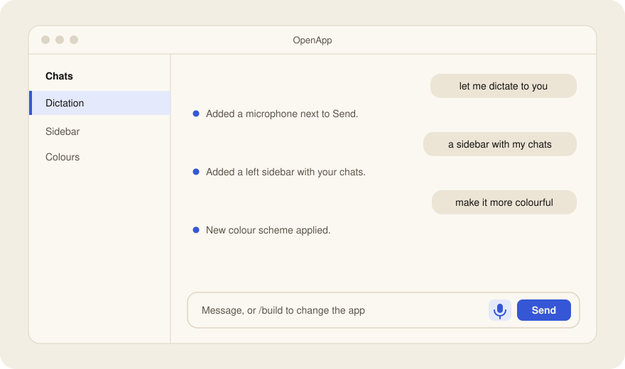

<div align="center">

# OpenApp

**Your app, built by asking.**

One interface on your Mac that its own agent builds around your life —
features, themes, pets, windows, connectors. The only limit is what you can describe.

[](LICENSE)


[Website](https://martin-atrin.github.io/openapp/) · [Download](https://github.com/Martin-Atrin/openapp/releases/latest) · [How it works](#how-it-works) · [Contract](spec/CONTRACT.md)



</div>

## Why

You build a feature for yourself, and next month it ships inside somebody else's app. Your workflow ends up spread
across five AI apps that each do eighty percent of what you need.

OpenApp starts from a clean slate instead. It opens as a single chat box. You describe what you need — a dictation
button, an inbox for your work mail, a music studio, a cat that sits on your sidebar — and the agent builds it into
the app while you watch. Nothing restarts. Next week you ask for something else. The app grows with you and stays
yours: a folder of plain files on your Mac, versioned with git.

| You get | How |
|---|---|
| A UI that grows on request | The agent writes **modules** (views + optional backends); the app hot-loads them |
| An agent with its own world | A private Linux VM per workspace (Debian, Node, Python, apt) where the agent works without prompts |
| Your Mac on your terms | Microphone, folders, Calendar, on-device Apple Intelligence and more — only through consent cards |
| Services connected safely | Tokens stay in your macOS Keychain; requests are signed on the Mac, never inside the VM |
| Undo and a record | Every build can be undone; network, consent and build activity are logged locally |

> **Early alpha (0.1).** macOS 26 on Apple silicon only. The agent runs on [Pi](https://github.com/earendil-works/pi):
> sign in with ChatGPT or Claude, or use an OpenAI or Anthropic API key. Other providers show as *Coming soon*.

## How it works

```
  your Mac ─────────────────────────────────────────────────────────────────────
  │ OpenApp.app                                                                 │
  │   Shell ── the window you see, rendering whatever the agent placed           │
  │   Kernel (Rust) ── layout, sessions, consent, secrets, the network proxy     │
  │   Host services ── microphone, on-device Speech + Apple Intelligence, Vision │
  │   Host modules ── Swift the agent writes for anything else on macOS          │
  │              ▲   one authenticated bridge: every crossing is a building   │
  │              ▼   block with a consent rule (free / ask once / ask always)   │
  │ The agent's VM (Linux, no network card)                                     │
  │   the agent (Pi) · module servers and daemons · /workspace = your app (git)   │
  ───────────────────────────────────────────────────────────────────────────────
```

The kernel never ships features. It ships building blocks — views, live channels, services, files, jobs, scoped
agents, secrets, the native shell (windows, menus, tray, shortcuts) — and the agent assembles features from them.
A feature is a module. The smallest one is all of dictation:

```json
{ "id": "dictation",
  "views": { "mic": { "kind": "spec", "file": "views/mic.json" } },
  "placements": [{ "view": "mic", "anchor": "composer.actions" }] }
```

```json
{ "type": "icon-button", "icon": "mic", "label": "Dictate",
  "action": { "host": "audio.record", "transcribe": "apple", "insert": true } }
```

The recording stays on your Mac and is transcribed on-device. When a feature needs state or an outside service, the
agent adds a backend — an MCP server in any language — inside the VM. The full API is in
[`spec/CONTRACT.md`](spec/CONTRACT.md).

## What the agent has built

We test OpenApp by asking its agent to build twelve real apps from one request each, in fresh workspaces, unattended.
In the latest run it built ten up to the steps only a person can do (signing in, approving access): a Proton Mail
client with the Bridge as a VM service, a GarageBand-style studio, a terminal + editor + preview, LibreOffice in a view,
a unified IMAP inbox, Telegram as your own account, a Photos grid, a file manager with a Markdown editor, a WebGPU
gamepad game, and a Home Assistant + Bluetooth panel. Results and transcripts: [`eval/probes`](eval/probes).

## Install

**Download:** get `OpenApp.app` from the [latest release](https://github.com/Martin-Atrin/openapp/releases/latest), move it to
Applications and open it. On first start it prepares its VM (a few minutes, about 2 GB of disk).

**Build from source:**

```bash
pnpm install
```

```bash
node scripts/fetch-runtime.ts
```

```bash
pnpm tauri build --bundles app
```

`fetch-runtime.ts` downloads the pinned VM runtime (microsandbox 0.7.8) and checks its sha256. Building needs Rust
(pinned in `src-tauri/rust-toolchain.toml`), Node 24+, pnpm and Xcode 26. Tests: `pnpm test` — see
[`TESTING.md`](TESTING.md).

## First run

1. **Pick your provider:** *Pi · isolated VM*.
2. **Sign in** with ChatGPT or Claude, or an API key. The model list comes from your account; choose one in the model
   chip next to the composer, and mark a stronger one the agent may ask for on hard tasks.
3. **Ask.** Plain messages are chat; start with **`/build`** when you want the agent to change the app.

## What OpenApp promises, and what it doesn't yet

- The agent and its code run in a VM with **no network card**; every connection goes through the kernel's proxy and
  is logged on your Mac. New sites, the microphone, camera, folders, clipboard and macOS data need **your approval**.
  Host modules show their source changes before they run.
- Passwords and tokens live in your **Keychain**; the agent only sees their names. The record of grants and builds
  lives outside the folder the VM can see.
- **Not yet:** modules inside the VM are not isolated from each other; web content is not yet labelled as untrusted
  when the agent reads it; builds are not signed or notarized. See [`spec/ROADMAP.md`](spec/ROADMAP.md).

## Project layout

| Path | What |
|---|---|
| `src-tauri/src/` | Rust kernel: `kernel/`, `primitives/`, Pi/Codex/ACP adapters, VM, egress, secrets |
| `src/` | React shell |
| `src-tauri/macos-services/` | Swift helper for on-device macOS services |
| `src-tauri/vm/guest-image/` | Recipe for the Linux guest image |
| `workspace-template/` | The builder skill and agent instructions shipped into every workspace |
| `eval/` | Probe definitions and results |
| `site/` | This project's website (GitHub Pages) |
| `spec/` | Contract, roadmap, implementation notes |

## Licence

Apache License 2.0 — see [`LICENSE`](LICENSE). OpenApp bundles [microsandbox](https://github.com/superradcompany/microsandbox)
(Apache-2.0) and `libkrunfw`, which contains a Linux kernel under GPL-2.0; the source offer and all other notices are
in [`THIRD-PARTY-NOTICES.md`](THIRD-PARTY-NOTICES.md).
